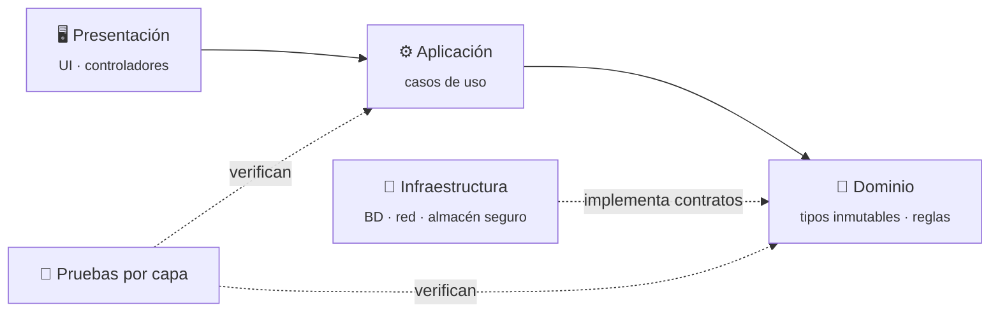

<!-- ░░ Encabezado ░░ -->
<p align="center">
  
</p>

<p align="center">
  <a href="https://alnuxe.github.io/Portafolio/">
    
  </a>
</p>

<p align="center">
  <a href="https://alnuxe.github.io/Portafolio/"></a>
  <a href="https://www.linkedin.com/in/daniel-alejandro-estrada-olalde-532a16233/"></a>
  <a href="mailto:ingeniero.alejandro.estrada@gmail.com"></a>
</p>

<p align="center">
  
  
  
  
</p>

---

### `$ whoami`

```ts
const alnuxE: SoftwareEngineer = {
  nombre:      "Daniel Alejandro Estrada Olalde",
  rol:         "Backend Developer @ Fay Publicidad · Metrix",
  produccion:  { desde: "2024-04", clientes: ["Walmart", "Waldos", "P&G"] },
  formacion:   "Ingeniería en Informática · UPIICSA-IPN (9.º semestre)",
  enfoque:     ["arquitectura por capas", "pruebas automatizadas", "datos a gran volumen"],
  despliegue:  ["Docker", "Kubernetes (GKE Autopilot)", "CI/CD", "Nginx"],
  idiomas:     { es: "nativo", en: "B1/B2 · documentación técnica" },
};
```

Escribo backend para sistemas en producción con volúmenes de datos altos, consultas que tienen que responder rápido y despliegues con gente esperando al otro lado. Fuera del trabajo diseño y publico mis propias aplicaciones de principio a fin —arquitectura, pruebas y publicación—, que es donde se aprende lo que un tutorial no enseña: qué hacer cuando la red se cae a mitad de una operación o por qué una decisión cómoda hoy se paga en tres meses.

---

### 📐 Ingeniería en números

<div align="center">

| Pruebas automatizadas | Apps publicadas | Ficheros bajo prueba | Plataformas | En producción desde |
|:---:|:---:|:---:|:---:|:---:|
| **808** ✅ | **3** | **218** | **4** | **2024** |

</div>

> Mis apps son privadas: lo que se puede auditar son las cifras y las decisiones de ingeniería. Las detallo abajo.

---

### 🏗️ Cómo construyo software

Separo cada sistema en capas con dependencias en un solo sentido. En SwitchIot **una prueba falla si alguna capa importa hacia arriba**, así la arquitectura no se erosiona con el tiempo.



| Principio | Cómo se ve en el código |
|---|---|
| **Probar, no afirmar** | Cada capa se prueba sin arrastrar a las demás; 808 pruebas entre tres apps. |
| **Una sola fuente de verdad** | Los totales se calculan, nunca se escriben a mano. |
| **Fallar de forma segura** | Apps que funcionan sin conexión; la red es una mejora, no un requisito. |
| **Seguridad desde el diseño** | Una credencial por dispositivo, guardada en el almacén seguro del sistema. |

---

### 🚀 Proyectos destacados

| App | Qué resuelve | Pruebas | Ficheros | Plataformas |
|---|---|:---:|:---:|---|
| 🔌 **SwitchIot** `v1.1.0` | Control de una bomba de agua sobre **ESP32** por red local, sin nube y sin cuenta. | **338** | 85 | Android · Linux · Windows |
| ✍️ **PromptEngine** `v1.4.0` | Compositor de prompts por secciones con vista previa en vivo y salida en Markdown. | **320** | 54 | Android · Web · Linux |
| 📚 **Classly** `v1.0.0` | Horario académico y tareas con el dominio en tipos inmutables. Funciona sin conexión. | **150** | 79 | Android |

<details>
<summary><b>🔍 Decisiones de ingeniería por proyecto</b> (clic para expandir)</summary>
<br>

**SwitchIot**
- Descubre los equipos por **difusión UDP** y, si la red la bloquea, **barre la subred** como respaldo.
- Aprovisiona el ESP32 desde su propio punto de acceso, sin servidor de por medio.
- Una credencial por dispositivo, guardada en el almacén seguro del sistema.
- Registra tiempos de extremo a extremo y el registro sobrevive al cierre de la app.

**PromptEngine**
- Cada sección del prompt es una pieza independiente que se reordena sin romper las demás.
- La vista previa se recalcula en vivo y exporta Markdown limpio.
- Su sitio corre en un servidor propio, en contenedores, detrás de **Nginx** como proxy inverso.

**Classly**
- Dominio modelado en tipos inmutables: un horario no se corrompe a medias.
- *Offline-first*: la red es una mejora, no un requisito.

</details>

---

### 💼 Experiencia

**Desarrollador Backend · Fay Publicidad · Metrix** — *abril 2024 → hoy*
<sub>Sistemas en producción usados por **Walmart**, **Waldos** y **P&G**</sub>

- Aplicaciones **Laravel** dentro de un monorepo desplegado sobre **Kubernetes (GKE Autopilot)** con integración y despliegue continuos.
- Consultas complejas sobre grandes volúmenes en **MySQL** y **MongoDB**, con foco en el tiempo de respuesta de los reportes de negocio.
- Funcionalidades de extremo a extremo, desde el modelo de datos hasta la interfaz.
- Diagnóstico de incidencias en producción: reproducir, acotar la causa con el equipo y después tocar código.

---

### 🧰 Stack por capas

| Capa | Tecnologías |
|---|---|
| **Backend** |  |
| **Datos** |  |
| **Plataforma** |  |
| **Móvil** |  |
| **Web** |  |

**Práctica:** arquitectura limpia · arquitectura por capas · microservicios · pruebas automatizadas · revisión de código · documentación de API · POO y programación funcional

---

### 📈 Actividad

<p align="center">
  
</p>

<p align="center">
  <picture>
    <source media="(prefers-color-scheme: dark)" srcset="https://raw.githubusercontent.com/alnuxE/alnuxE/output/github-snake-dark.svg">
    <source media="(prefers-color-scheme: light)" srcset="https://raw.githubusercontent.com/alnuxE/alnuxE/output/github-snake.svg">
    
  </picture>
</p>

<p align="center">
  
</p>
